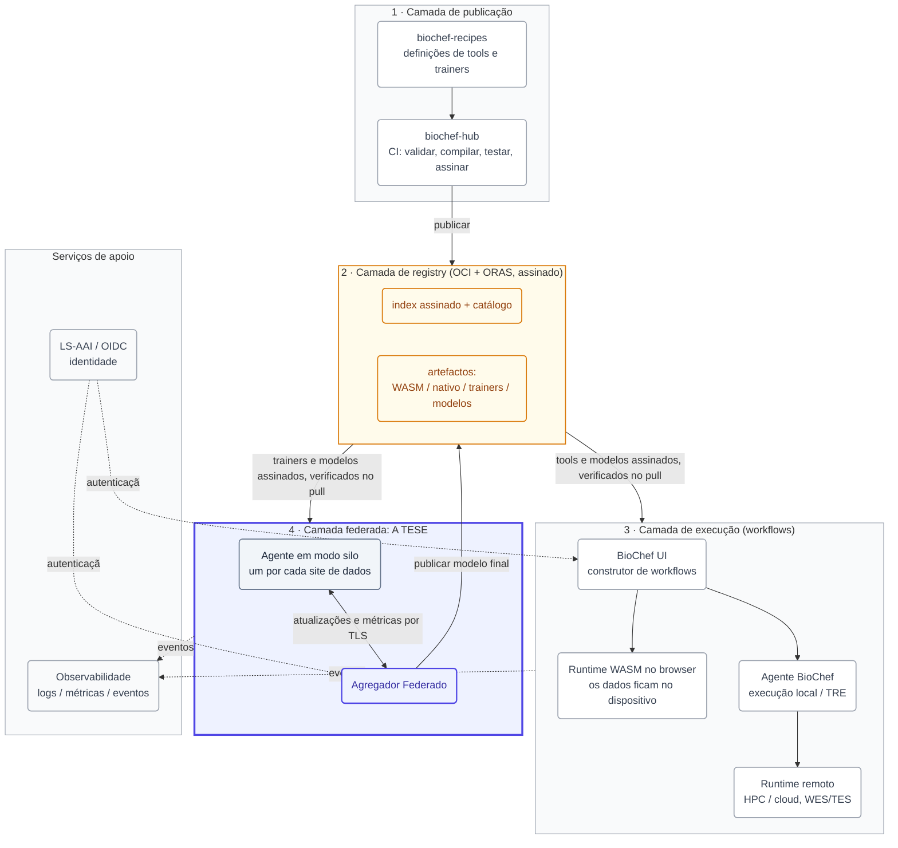
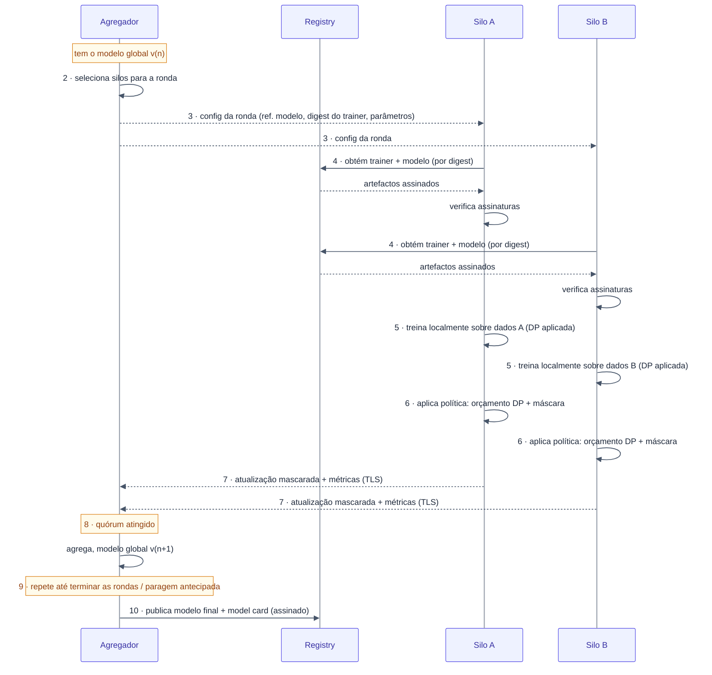

# A camada de Federated Learning do BioChef: arquitetura e desenho

Documento de desenho autónomo para a dissertação de mestrado sobre a camada de federated learning (FL) do BioChef. Está escrito para ser lido de fio a pavio. Avança do sistema inteiro, para a camada de FL como um todo (o teu território), para os componentes que vais desenhar e construir. Lê-o uma vez para te orientares e depois volta à Parte 3 como referência de trabalho durante a implementação.

Este documento reflete o sistema tal como está em 2026: o que já existe em código, o que está especificado mas ainda não construído, e o que é, portanto, teu para desenhar. Estas três categorias são mantidas explicitamente separadas ao longo do texto, porque o erro mais caro que podes cometer cedo é procurar código que ainda não existe, ou reconstruir algo que já existe.

## Parte 0. Como ler este documento

- **A Parte 1 (a visão global)** é o que o BioChef é, porque existe e como as suas peças encaixam. Toda a gente no projeto devia conseguir desenhar isto de memória.
- **A Parte 2 (o teu global)** é a camada de FL como um único subsistema: os seus atores, os seus fluxos de dados, as suas fronteiras de confiança, e uma ronda de treino completa de início ao fim. É o nível a que vais explicar a tua tese numa defesa.
- **A Parte 3 (os detalhes)** é componente a componente: interfaces, estruturas de dados, protocolos, a maquinaria de privacidade, e as decisões que tens de tomar. É aqui que vais viver durante a implementação.
- **A Parte 4** é a sequência de construção e as questões de desenho em aberto, para saberes sempre qual é a próxima decisão.

Um glossário curto fecha o documento.

## Parte 1. A visão global: o que é o BioChef

### 1.1 O problema

Os dados genómicos e clínicos estão entre os dados mais sensíveis que existem. Um genoma identifica um indivíduo de forma única, é partilhado em parte com os seus familiares, revela predisposição para doenças, e não pode ser revogado nem alterado depois de uma fuga. A lei trata-os em conformidade: ao abrigo do RGPD, os dados genéticos são uma categoria especial de dados pessoais, com limites estritos ao processamento e à transferência transfronteiriça.

Isto colide com a forma como a análise de dados costuma funcionar. O padrão habitual é mover os dados para onde está a computação: carregar para um servidor, uma plataforma cloud, ou um cluster partilhado, e correr a análise lá. Para dados sensíveis, é essa movimentação que é o problema. Cada cópia é um risco, cada transferência atravessa uma fronteira de governação, e para muitos conjuntos de dados simplesmente não é permitida.

A resposta que emergiu na área é um princípio: **não mover os dados; levar a computação até aos dados.** Manter os dados dentro da instituição que os governa, e levar até eles a análise (ou o treino do modelo), devolvendo apenas resultados seguros de divulgar. O BioChef é uma concretização desse princípio, dirigida à genómica e à saúde.

### 1.2 A ideia do BioChef

O BioChef permite a um utilizador construir uma análise como um workflow, um grafo de ferramentas, e executar cada passo no local que melhor serve os dados e a computação, sem ter de instalar nada nem gerir infraestrutura. Há três cenários de execução:

1. **No browser.** As ferramentas de bioinformática são compiladas para WebAssembly (WASM) e correm no lado do cliente. Os dados nunca saem da máquina do utilizador. É ideal para análises leves sobre ficheiros locais.
2. **Num Agente institucional.** Um componente implantável corre ferramentas mais pesadas num servidor, ou dentro de um Trusted Research Environment (TRE) onde vivem dados controlados. Os dados ficam dentro da instituição; o Agente corre onde os dados já estão.
3. **Em HPC ou cloud remotos**, através de serviços padrão de execução de workflows, quando um passo precisa de computação séria e a política o permite.

Por baixo dos três está um princípio de **artefactos verificáveis**: cada ferramenta é um pacote assinado e versionado, obtido de um registry partilhado, e cada ambiente de execução verifica a assinatura antes de correr o que quer que seja. Sabes sempre exatamente que código correu.

O federated learning é a extensão natural deste princípio, da análise pontual ao treino de modelos. Se os dados não podem ser centralizados, então também o conjunto de treino não pode. Por isso, em vez de recolher dados para treinar um modelo, o BioChef envia o treino a cada site que detém dados, treina localmente, e combina apenas as atualizações de modelo resultantes. Essa capacidade de FL é o objeto desta dissertação.

### 1.3 As quatro camadas

O BioChef organiza-se em quatro camadas lógicas mais serviços de apoio. Não precisas de dominar as quatro, mas precisas de saber para que serve cada uma, porque o teu trabalho toca em todas.

1. **Camada de publicação.** Como as ferramentas e os trainers são definidos, testados e construídos. Os programadores escrevem uma *recipe* estruturada (um ficheiro YAML que descreve uma ferramenta: a sua origem, como a construir, os seus inputs e outputs). Um pipeline de CI (o "Hub") valida, compila, testa, assina e publica.
2. **Camada de registry.** Onde vivem os artefactos construídos. O BioChef usa um registry OCI padrão (o mesmo tipo de registry que guarda imagens de contentores) para guardar não só contentores mas artefactos arbitrários: binários WASM, binários nativos, pacotes de metadados, e modelos treinados. Tudo é endereçado por conteúdo e assinado. Um *index* assinado lista tudo o que está disponível; um *catálogo* leve alimenta a UI.
3. **Camada de execução.** Onde os workflows realmente correm: o runtime WASM no browser, o Agente, e os conectores remotos. A UI (uma aplicação web de página única) é onde os utilizadores compõem workflows como grafos e escolhem onde cada passo corre.
4. **Camada federada.** Onde as sessões de FL são orquestradas entre vários sites: o Agente em modo silo em cada site de dados e o Agregador Federado central. **Esta camada é a tese.**

Os serviços de apoio atravessam as quatro camadas: **identidade** (LifeScience AAI / ELIXIR AAI, um fornecedor OIDC, para que o acesso esteja ligado a identidades reais e verificadas), **observabilidade** (logs, métricas e eventos de cada componente), e um **gateway de LLM** opcional (uma interface MCP que deixa assistentes de IA planear workflows sobre a mesma cadeia de ferramentas verificada).

O sistema inteiro, com o registry no centro e a camada federada (o teu trabalho) destacada:

### 1.4 O que existe hoje (importante)

Sê preciso sobre a linha de partida:

- **Implementado e a funcionar:** o runtime WASM no browser, o pipeline de recipes e do Hub, o registry OCI com artefactos assinados, a UI de workflows, e um **Agente que executa workflows localmente**. Na plataforma atual, esse Agente recebe um workflow da UI, converte-o numa representação intermédia, e corre-o através do **Snakemake** como backend. Nas palavras do próprio autor, o Agente "funciona como backend de execução local". Faz apenas execução de workflows.
- **Especificado mas não implementado:** tudo o que é federado. O modo silo do Agente, o Agregador Federado, o protocolo de rondas de FL, a maquinaria de privacidade diferencial e de agregação segura, o ciclo de vida dos artefactos de trainer e modelo para FL, e a aba federada na UI. Estão descritos no documento de arquitetura do BioChef, mas são um desenho no papel, não código a correr.

Por isso, quando leres "o Agente", segura duas ideias ao mesmo tempo: existe um Agente **real** hoje (um executor de workflows sobre Snakemake), e existe um Agente em modo silo **desenhado** (um cliente de treino de FL) que vais construir, idealmente estendendo o real em vez de começar do zero.

## Parte 2. O teu global: a camada de federated learning como um todo

Esta parte é o nível a que devias conseguir explicar a tua tese inteira sem apontamentos. Define o subsistema de FL: os seus atores, as fronteiras de confiança que o tornam significativo, os artefactos que circulam, e uma ronda completa de início ao fim.

### 2.1 O que "federated learning" tem de significar aqui, e o que não significa

Federated learning, numa linha: várias partes treinam um modelo partilhado sem partilhar os seus dados em bruto; cada uma treina localmente e envia apenas atualizações de modelo, que um coordenador combina num modelo global.

Essa definição é necessária mas não suficiente para dados genómicos sensíveis, e é exatamente nessa lacuna que vive a tua contribuição de investigação. "Os dados em bruto nunca se movem" soa a privacidade, mas não é, por si só, uma garantia de privacidade:

- Um modelo treinado pode **deixar fugir os seus dados de treino**. Dado apenas acesso de consulta a um modelo, um adversário consegue muitas vezes inferir se o registo de uma pessoa específica esteve no conjunto de treino (um ataque de *inferência de pertença*). Para dados genómicos, "esta pessoa esteve na coorte de diabetes" pode ser, em si, o facto sensível.
- Uma única atualização, sobretudo um gradiente, pode **reconstruir exemplos de treino**. A partir dos gradientes que um site envia numa ronda, um adversário consegue em certos cenários recuperar os próprios inputs (um ataque de *fuga por gradientes*).

Por isso uma camada de FL credível para genómica precisa de três coisas em cima do simples "treinar localmente, enviar atualizações":

1. **Agregação segura**, para que o coordenador aprenda apenas a *soma* das atualizações dos sites, nunca a atualização individual de um site qualquer.
2. **Privacidade diferencial (DP)**, para que o modelo divulgado carregue uma quantidade limitada e quantificada de informação sobre qualquer registo individual, adicionando ruído calibrado durante o treino e seguindo um orçamento de privacidade.
3. **Um modelo de ameaça**, uma afirmação explícita de quem é o adversário, o que pode ver, e o que pode fazer, contra o qual as duas anteriores são avaliadas.

Estas três não são extras opcionais para aparafusar no fim. São a espinha dorsal da tese. A engenharia (silo, agregador, UI) é o corpo; a análise de privacidade é a espinha que a torna uma contribuição, e não apenas uma implementação.

### 2.2 Os atores

Há quatro atores na camada de FL. Dois constróis, dois integras.

- **O Agregador Federado** (constróis). O coordenador central. Gere sessões e rondas, distribui configurações de ronda, recolhe atualizações, corre a estratégia de agregação, e publica o modelo final. Nunca vê dados em bruto; com agregação segura, nem sequer vê atualizações individuais.
- **O Agente em modo silo** (constróis, estendendo o Agente existente). Um por cada site que detém dados. Inscreve-se no Agregador, obtém o trainer e o modelo atual, treina localmente sobre os dados do site, aplica a maquinaria de privacidade, e devolve apenas atualizações e métricas. Os dados em bruto ficam sempre dentro da fronteira do silo.
- **O Registry** (integras). Já existe. Guarda trainers e modelos como artefactos assinados. O silo obtém daqui trainers e modelos e verifica assinaturas; o Agregador publica aqui os modelos terminados.
- **Identidade / LS-AAI** (integras). Já existe como conceito na plataforma. O fornecedor OIDC que autentica os utilizadores humanos da UI federada e autoriza as suas ações.

Um modelo mental útil: o **Agregador é um maestro** que nunca toca um instrumento, e cada **silo é um músico** que toca só em casa, à porta fechada, e manca para fora apenas uma gravação com ruído misturado. O maestro combina as gravações sem nunca entrar em nenhuma sala.

### 2.3 As fronteiras de confiança (a parte que mais importa)

Tudo o que faz disto um sistema de privacidade, e não apenas treino distribuído, é uma questão de fronteiras. Desenha-as com clareza e o resto segue.

- **A fronteira do silo.** À volta de cada site. Os dados de treino em bruto vivem estritamente dentro dela. A atravessar para fora: apenas atualizações de modelo e métricas agregadas, e só depois de a política do site ter sido aplicada sobre elas. Nada de entrada é confiável sem uma verificação de assinatura (os contentores de trainer e os pesos do modelo são verificados antes de correrem).
- **O agregador honesto-mas-curioso.** O pressuposto padrão é que o Agregador segue o protocolo mas tenta aprender o que puder daquilo que legitimamente recebe. É precisamente por isso que a agregação segura importa: retira ao Agregador a capacidade de inspecionar a atualização individual de um site, mesmo sendo ele a combiná-las.
- **A rede.** Entre os silos e o Agregador. Sempre TLS. O silo consulta para fora (inicia as ligações); o Agregador não entra dentro do site. Esta propriedade de "só saída" não é um detalhe, é muitas vezes o que torna a implantação dentro de um TRE real possível de todo, porque os TRE costumam proibir ligações de entrada.
- **A fronteira de divulgação.** O modelo final, publicado, atravessa de "interno à federação" para "disponível aos utilizadores". A DP é o controlo aqui: limita o que esse modelo divulgado pode revelar sobre qualquer indivíduo cujos dados o treinaram.

Se conseguires, num quadro, desenhar estas quatro fronteiras, nomear o que pode atravessar cada uma e em que forma, e dizer que mecanismo aplica cada travessia, percebeste a tese.

As fronteiras, desenhadas. As cores: vermelho para dados sensíveis que nunca saem, azul para o agregador, âmbar para o registry, verde para a saída segura. Para fora de cada silo atravessam apenas atualizações mascaradas e métricas; para dentro, só o que está verificado por assinatura; e o modelo divulgado é controlado por DP:

```mermaid
%%{init: {'theme':'base','themeVariables':{'fontFamily':'Segoe UI, Helvetica, Arial, sans-serif','fontSize':'14px','lineColor':'#6b7280','primaryColor':'#f9fafb','primaryTextColor':'#111827','primaryBorderColor':'#9ca3af'},'flowchart':{'curve':'basis','nodeSpacing':50,'rankSpacing':70,'padding':12}}}%%
flowchart LR
    subgraph SILOA["FRONTEIRA DO SILO · site A (ex.: um TRE)"]
        DA[("dados em bruto A<br/>nunca saem")]
        TA("trainer<br/>DP aplicada")
        PA("política + orçamento DP + máscara")
        DA --> TA --> PA
    end
    subgraph SILOB["FRONTEIRA DO SILO · site B"]
        DB[("dados em bruto B<br/>nunca saem")]
        TB("trainer<br/>DP aplicada")
        PB("política + orçamento DP + máscara")
        DB --> TB --> PB
    end
    AGG("Agregador Federado<br/>honesto-mas-curioso:<br/>vê só a SOMA,<br/>nunca a atualização de um site")
    REG("Registry<br/>trainers e modelos assinados")
    REL("modelo divulgado<br/>limitado por DP")
    PA -->|atualização mascarada + métricas, TLS, só saída| AGG
    PB -->|atualização mascarada + métricas, TLS, só saída| AGG
    REG -.->|trainer + modelo assinados, verificados antes de correr| SILOA
    REG -.->|trainer + modelo assinados, verificados antes de correr| SILOB
    AGG -->|publicar, assinado| REG
    AGG --> REL
    classDef data fill:#fef2f2,stroke:#dc2626,stroke-width:2px,color:#991b1b;
    classDef silo fill:#f1f5f9,stroke:#64748b,stroke-width:1.5px,color:#1e293b;
    classDef agg fill:#eef2ff,stroke:#4f46e5,stroke-width:2px,color:#3730a3;
    classDef reg fill:#fffbeb,stroke:#d97706,stroke-width:2px,color:#92400e;
    classDef safe fill:#ecfdf5,stroke:#059669,stroke-width:2px,color:#065f46;
    class DA,DB data
    class TA,TB,PA,PB silo
    class AGG agg
    class REG reg
    class REL safe
    style SILOA fill:#fdf6f6,stroke:#dc2626,stroke-width:2.5px
    style SILOB fill:#fdf6f6,stroke:#dc2626,stroke-width:2.5px
```

### 2.4 O que atravessa a rede (e o que nunca atravessa)

| Atravessa a fronteira do silo para fora | Nunca atravessa |
|---|---|
| Atualizações de modelo (mascaradas, se a agregação segura estiver ligada) | Registos de treino em bruto |
| Métricas agregadas (ex.: precisão local, perda, contagem de amostras) | Dados ao nível do registo, de qualquer tipo |
| Uma impressão digital da política do site (na inscrição) | O conjunto de dados, no todo ou em parte |
| Anúncio de capacidades (o que o site sabe treinar) | Qualquer coisa que não passe a política de output do site |

A assimetria desta tabela *é* o desenho. Tudo na coluna da esquerda é derivado, agregado e verificado pela política; tudo na coluna da direita é proibido por construção.

### 2.5 Uma ronda federada completa, de início ao fim

Este é o batimento cardíaco do sistema. Uma sessão são muitas rondas; uma ronda é a sequência seguinte. Interioriza-a; tudo na Parte 3 é um detalhe de um destes passos.

1. **Baseline.** O Agregador tem o modelo global atual (versão *n*). Logo na primeira ronda este é um modelo recém-inicializado.
2. **Seleção.** O Agregador seleciona que silos participam nesta ronda (todos, ou um subconjunto).
3. **Configuração da ronda.** O Agregador emite uma config de ronda: uma referência ao modelo global atual, a **imagem do trainer a usar (fixada pelo seu digest no registry)**, e os parâmetros de treino da ronda (épocas locais, tamanho de batch, taxa de aprendizagem, e os parâmetros de privacidade em vigor).
4. **Obter e verificar.** Cada silo participante obtém a config da ronda, depois obtém a imagem do trainer referenciada e o modelo atual a partir do Registry, e **verifica as suas assinaturas antes de correr o que quer que seja.**
5. **Treino local.** O silo corre o contentor do trainer sobre os seus próprios dados, durante o número de épocas configurado, partindo do modelo global atual. O trainer aplica o mecanismo de DP configurado durante o treino. Os dados em bruto nunca saem do silo.
6. **Aplicação local da privacidade.** Antes de algo ser enviado, o Agente aplica a política do site: verifica e contabiliza o orçamento de DP gasto, aplica a máscara de agregação segura à atualização, e corre quaisquer verificações de output que a política exija.
7. **Devolução.** O silo envia de volta apenas a atualização de modelo (mascarada) e as métricas agregadas, por TLS.
8. **Agregar.** Assim que o Agregador recebe as atualizações de que precisa (todos os silos selecionados, ou um quórum configurado), combina-as com a estratégia de agregação para produzir o modelo global versão *n+1*, e regista as métricas da ronda.
9. **Repetir ou parar.** Se o número de rondas configurado não foi atingido e não se cumpriu nenhuma condição de paragem antecipada, volta ao passo 2 com o novo modelo. Caso contrário, termina.
10. **Publicar.** O Agregador empacota o modelo final com as suas métricas e uma **model card** (um documento curto que descreve o que o modelo é, como foi treinado, e o seu uso e limites previstos), assina-o, e publica-o no Registry como artefacto OCI. Uma atualização do catálogo torna-o depois visível na UI.

Repara em duas coisas. Primeiro, a ronda é **simétrica na confiança**: o silo verifica o que obtém (assinaturas), e o Agregador só alguma vez recebe quantidades derivadas. Segundo, **o digest do registry no passo 3 é o que torna tudo reproduzível e verificável**, cada site correu, comprovadamente, exatamente o mesmo trainer.

A mesma ronda como sequência (mostram-se dois silos; na prática são muitos). É o diagrama para manter aberto enquanto constróis a Parte 3:

### 2.6 Onde fica a tua tese face ao trabalho de outras pessoas

- **Por baixo de ti (constróis em cima):** a plataforma existente, o Agente (execução de workflows), o registry, o pipeline de recipes/Hub, o esqueleto da UI. Estendes o Agente para o modo silo; não o reconstróis.
- **Ao teu lado (referência, não dependência):** o trabalho de federated Random Forest do grupo (Cotorobai et al., com PySyft). É um *método* que podes empacotar como trainer de referência para correr na tua infraestrutura. Não é a infraestrutura, e não estás a redemonstrá-lo.
- **Tu (a contribuição):** a camada de FL como subsistema a funcionar, *mais* a análise de privacidade (modelo de ameaça, contabilização do orçamento de DP, agregação segura, fuga medida e compromisso privacidade-utilidade) que a torna credível para dados genómicos num TRE.

## Parte 3. Os detalhes: componentes que vais desenhar e construir

Agora a referência de trabalho. Cada componente abaixo tem um propósito, uma fronteira, uma interface, e as decisões que tens de tomar. Trata as interfaces como uma proposta de partida que vais refinar no teu capítulo de desenho, não como lei imutável.

### 3.1 O Agente em modo silo

**Propósito.** Representar um site que detém dados numa federação. Treinar localmente, aplicar a política de privacidade do site, e devolver apenas outputs seguros.

**Fronteira.** Tudo o que faz acontece dentro da fronteira do silo. As únicas coisas que emite são atualizações, métricas, e (na inscrição) capacidades e impressões digitais da política.

**Relação com o Agente existente.** O Agente existente já sabe obter artefactos assinados do registry, verificá-los, e correr contentores. O modo silo acrescenta um cliente de FL por cima disso: inscrição, gestão de rondas, orquestração do treino local, o caminho de privacidade, e a atualização de saída. A intenção de desenho é que o *mesmo binário* corra em qualquer dos modos, escolhido por uma flag (conceptualmente `--silo-mode`) e um ficheiro de configuração.

**Responsabilidades, pela ordem de uma ronda:**

1. **Inscrever-se** no Agregador: registar-se, anunciar capacidades (que tipos e tamanhos de modelo sabe treinar, mais ou menos que computação tem), e publicar uma **impressão digital da sua política local** (não a política em si, um hash ou resumo, para o Agregador poder verificar compatibilidade sem o site expor as suas regras internas).
2. **Obter** a config da ronda de qualquer sessão em que participe.
3. **Obter e verificar** a imagem do trainer e o modelo atual a partir do registry (a verificação de assinatura é obrigatória e inegociável).
4. **Treinar** localmente: lançar o contentor do trainer sobre o conjunto de dados local durante as épocas configuradas, com DP aplicada durante o treino.
5. **Aplicar a política e privatizar**: contabilizar o orçamento de DP gasto, aplicar a máscara de agregação segura, correr verificações de output.
6. **Enviar** a atualização mascarada e as métricas ao Agregador por TLS.

**Configuração (proposta).** Dois ficheiros: uma config do Agente (a sua identidade, o URL do Agregador, o acesso ao registry, o material TLS) e uma **política do silo** (se a DP é exigida, o teto do orçamento de DP, se a máscara é exigida, e quaisquer restrições de output). A política é a governação do próprio site expressa como regras executáveis por máquina; o trabalho do Agente é *aplicá-la*, recusando-se a enviar o que quer que a viole.

**Decisões que tens de tomar.**
- O que é exatamente uma "atualização de modelo" para cada tipo de modelo (pesos completos, deltas de pesos, ou gradientes), e como é serializada.
- Como o estado do orçamento de DP persiste entre rondas para uma dada sessão (o orçamento de um site gasta-se de forma cumulativa, ronda após ronda).
- Como o trainer e o Agente dividem o trabalho de privacidade (o desenho tem o *trainer* a aplicar DP durante o treino e o *Agente* a seguir o orçamento e a mascarar, mantém essa separação limpa).

### 3.2 O Agregador Federado

**Propósito.** Coordenar a federação. Manter o estado das sessões e das rondas, conduzir o ciclo de rondas, agregar atualizações, publicar modelos.

**Fronteira.** É o maestro que nunca toca nos dados. Sob o modelo honesto-mas-curioso tem de ser *incapaz* (não apenas confiável para não o fazer) de inspecionar atualizações individuais assim que a agregação segura estiver em vigor.

**Responsabilidades.**
- Gerir o **ciclo de vida dos silos e das sessões**: que silos existem, quais aderiram a que sessão, em que estado está cada sessão.
- Por cada ronda: selecionar silos, emitir a config da ronda (referência do modelo, digest do trainer, parâmetros de treino e de privacidade), e esperar pelas atualizações.
- **Agregar** as atualizações recebidas no modelo global seguinte e registar as métricas da ronda.
- No fim da sessão, empacotar o modelo final com as métricas e uma model card, assiná-lo, e publicá-lo no registry; despoletar a atualização do catálogo para que apareça na UI.

**Duas superfícies de API (mantém-nas separadas).**
- **Voltada para o utilizador**, atrás de LS-AAI/OIDC: criar e listar sessões, selecionar silos, aderir ou sair, monitorizar o progresso das rondas, inspecionar modelos publicados. São ações que um humano toma através da UI, e são autorizadas contra a identidade verificada do utilizador.
- **Voltada para o silo**, máquina-a-máquina: inscrever-se e anunciar capacidades, obter configs de ronda, submeter atualizações. São chamadas pelos Agentes em modo silo, não por humanos.

**Persistência.** Precisa de estado durável: sessões, rondas, o conjunto de silos, métricas por ronda, e o modelo global atual entre rondas. (Um armazenamento relacional mais armazenamento de objetos para os blobs do modelo é a forma óbvia, mas justifica a tua escolha.)

**Decisões que tens de tomar.**
- A estratégia de agregação. Começa com **FedAvg** (pondera as atualizações dos sites pela contagem de amostras e faz a média), porque é a baseline contra a qual tudo o resto é medido. Trata FedProx, SCAFFOLD e agregação específica para árvores como acrescentos posteriores, e deixa a escolha de framework (3.5) influenciar o quão modular isto precisa de ser.
- A regra de **quórum**: têm de reportar todos os silos selecionados, ou uma fração? O que acontece quando um silo cai a meio da ronda? (A agregação segura tem de tolerar quedas; isto interage com 3.4.)
- Como uma config de ronda é versionada e tornada auditável, para que "que trainer correu na ronda 7 da sessão 3" tenha uma resposta comprovável.

### 3.3 Trainers e modelos como artefactos do registry

**Propósito.** Tornar as coisas que são treinadas, e as coisas que resultam, artefactos verificáveis de primeira classe, tal como as ferramentas BioChef normais.

**Como funciona.** Um **trainer** é empacotado como qualquer ferramenta: definido como recipe, construído e assinado pelo Hub, guardado no registry sob um ID e um digest estáveis. Um **modelo** produzido por uma sessão é guardado como artefacto OCI assinado, carregando os seus pesos, as suas métricas, e a sua model card. A mesma integridade de cadeia de abastecimento que protege as ferramentas (assinaturas, proveniência, endereçamento por conteúdo) protege a FL: cada site treina comprovadamente com o mesmo trainer, e cada modelo publicado é rastreável até à sessão e às rondas que o produziram.

**O que isto te dá.** Reprodutibilidade (fixar por digest), integridade (verificações de assinatura em cada pull), e proveniência (o artefacto do modelo referencia o histórico de sessão e de rondas que o criou).

**Decisões que tens de tomar.**
- O **formato do artefacto de modelo**: o que exatamente é guardado (pesos em que serialização, mais um documento de metadados), e como a model card é representada.
- A interface que um contentor de trainer tem de satisfazer para o Agente em modo silo o conduzir de forma uniforme entre tipos de modelo (que inputs espera, onde lê o modelo inicial, onde escreve a atualização e as métricas).
- Que **trainers de referência** entregar primeiro. Um par sensato: o trabalho de RF/XGBoost do grupo, baseado em árvores (como a referência interpretável e tabular), mais um modelo baseado em gradientes (para que o caminho de DP por gradientes e de agregação segura seja exercitado sobre algo neuronal).

### 3.4 A maquinaria de privacidade (a espinha de investigação)

É aqui que a tese ganha a sua contribuição. Constrói-a como parte de primeira classe do sistema, não como remendo.

**3.4.1 O modelo de ameaça.** Escreve-o de forma explícita e cedo. Indica, no mínimo: quem é o adversário (um agregador honesto-mas-curioso; um subconjunto de silos em conluio; um observador da rede), o que cada um pode ver (atualizações individuais? só o agregado? o modelo publicado?), e que ataques estão no âmbito (inferência de pertença contra o modelo divulgado; fuga por gradientes a partir das atualizações; inversão de modelo). Tudo o resto em 3.4 é avaliado contra esta afirmação, por isso ela tem de vir primeiro.

**3.4.2 Agregação segura.** O mecanismo pelo qual o Agregador obtém apenas a soma das atualizações, e não nenhuma individual. Os sites mascaram as suas atualizações de modo que as máscaras se cancelam quando somadas sobre a coorte; o Agregador recupera a soma verdadeira mas não aprende nada sobre nenhum contribuinte individual. O teu desenho tem de lidar com **quedas** (um site que mascara e depois desaparece não pode corromper a soma), que é a parte clássica difícil destes protocolos e interage com a regra de quórum do Agregador (3.2).

**3.4.3 Privacidade diferencial.** O mecanismo que limita o que o *modelo divulgado* revela sobre qualquer registo de treino individual, adicionando ruído calibrado durante o treino (trabalho do trainer) e seguindo um **orçamento de privacidade** cumulativo (épsilon) ao longo das rondas (trabalho do Agente). O orçamento gasta-se ao longo de uma sessão; quando se esgota, o site já não pode contribuir. Decide onde vive o contabilista de DP, como o estado do orçamento persiste, e como o épsilon aparece nas métricas e na model card.

**3.4.4 A avaliação.** É isto que transforma mecanismo em resultado. Quantifica a fuga (corre um ataque de inferência de pertença contra modelos treinados com e sem as tuas defesas e mede a diferença) e caracteriza o **compromisso privacidade-utilidade** (como a precisão do modelo degrada à medida que o orçamento de privacidade aperta). Uma curva limpa de privacidade-utilidade sobre uma tarefa genómica ou clínica, sob um modelo de ameaça declarado, é um resultado central publicável.

### 3.5 O backend de FL: encapsular ou construir (a tua primeira decisão de arquitetura)

Não tens de implementar as primitivas de federated learning de raiz, e deves decidir deliberadamente se o fazes. Esta é a primeira bifurcação real da tese e molda tudo o que vem depois.

- **Encapsular um framework existente** (ex.: Flower ou NVFlare): herdas orquestração de FL já testada, e no caso do NVFlare componentes de DP e de agregação segura já incluídos, e gastas o teu esforço na integração com o Agente, o registry e a aplicação da política, e na análise de privacidade.
- **Construir de raiz no Agente:** controlo máximo e o encaixe mais limpo com o modelo de artefactos e de política já existente no BioChef, ao custo de reimplementar a orquestração e as primitivas de privacidade tu próprio.

A decisão deve sair da avaliação de frameworks (ver `fl-frameworks.md`), julgada primeiro pela **implantabilidade num TRE** (consegue um site correr só de saída, com pegada pequena e sem portas de entrada?), depois pelo suporte a privacidade, depois pelo quão limpa é a integração com o Agente, o registry e o LS-AAI. Escolhas o que escolheres, justifica-o no capítulo de desenho contra esses critérios; esta é uma decisão defensável e examinável, e os examinadores vão procurar o raciocínio, não a resposta.

### 3.6 A aba federada na UI

**Propósito.** Deixar um utilizador autenticado conduzir a federação: criar e acompanhar sessões, selecionar silos, ver as rondas progredir, e inspecionar modelos publicados.

**Fronteira.** É uma superfície de controlo, não uma superfície de dados. Mostra o estado das sessões, as métricas das rondas, e os metadados dos modelos; nunca mostra dados em bruto, e nunca mostra as atualizações em bruto de sites individuais.

**Pontos de integração.** Fala com a API *voltada para o utilizador* do Agregador, autentica-se através do LS-AAI (OIDC), e lê os metadados dos modelos publicados a partir do registry/catálogo como qualquer outro modelo no BioChef. Subscreve eventos de observabilidade para mostrar o progresso das rondas em tempo real.

### 3.7 Identidade e observabilidade (integra, não inventes)

- **LS-AAI / OIDC.** Já é a espinha de identidade da plataforma. O Agregador trata-o como o emissor OIDC para a sua API voltada para o utilizador; a UI redireciona os utilizadores para ele no login. Consome-lo; não o constróis.
- **Observabilidade.** Já é o canal de eventos e métricas da plataforma. O Agregador reporta para ele a atividade de sessão e por ronda; o silo reporta os eventos do ciclo de vida das rondas. A UI consome uma vista filtrada para o progresso em tempo real, e os operadores têm o fluxo completo para dashboards e auditoria. O teu trabalho é *emitir* os eventos certos, não construir o pipeline.

## Parte 4. Sequência de construção e questões em aberto

### 4.1 Uma ordem sã de construção

Não constróis isto pela ordem em que está escrito. Constróis a coisa mais fina que corre de início ao fim, e depois aprofundas. Uma sequência exequível:

1. **Trabalho de base da pré-tese** (esta fase): aprender os fundamentos de FL e de TRE, ler este documento e a tese da plataforma, e correr a avaliação de frameworks que resolve 3.5.
2. **Uma fatia vertical fina:** um trainer de referência, dois silos, FedAvg simples, ainda sem privacidade, a falar com um Agregador mínimo, de início ao fim sobre dados não-IID **sintéticos**. O objetivo é provar que o ciclo de ronda de 2.5 funciona.
3. **Integração com o registry:** trainers e modelos como artefactos assinados (3.3), para que a fatia corra sobre componentes verificados.
4. **A camada de privacidade:** modelo de ameaça primeiro, depois contabilização de DP, depois agregação segura, depois a avaliação de fuga e de compromisso (3.4). É a espinha; dá-lhe o máximo de tempo.
5. **A aba federada na UI e o LS-AAI** (3.6, 3.7).
6. **Validação em TRE:** implantar entre silos no TRE do IST e correr a avaliação sobre dados reais ou realistas.

O princípio da ordenação: **chegar a uma ronda a correr o mais depressa possível, depois torná-la privada, depois torná-la real.** Uma análise de privacidade em cima de um sistema que ainda não treina não vale nada; um sistema de treino sem análise de privacidade não é a tese.

### 4.2 Questões de desenho em aberto (decisões tuas a tomar e a defender)

- Encapsular um framework ou construir de raiz? (3.5). A primeira e mais consequente.
- O que é precisamente uma "atualização de modelo" por tipo de modelo, e como é serializada? (3.1, 3.3)
- Onde vive o contabilista de DP e como persiste o orçamento entre rondas? (3.1, 3.4.3)
- Qual é a regra de quórum, e como interagem a agregação segura e o tratamento de quedas com ela? (3.2, 3.4.2)
- Qual é o formato do artefacto de modelo e o esquema da model card? (3.3)
- Que trainers de referência entram primeiro, e o primeiro trainer baseado em gradientes reutiliza o trabalho do grupo ou uma baseline padrão? (3.3)

### 4.3 Riscos a gerir cedo

- **O acesso ao TRE** (tanto os dados como o direito a implantar) está no caminho crítico. Garante-o durante a fase de pré-tese, antes de a construção depender dele.
- **Os dados genómicos reais** podem demorar a obter pelos canais FEGA/GDI. Mantém um conjunto de dados não-IID **sintético** (ex.: via partição de Dirichlet) como alternativa, para que a validação nunca fique bloqueada por acesso a dados.
- **Âmbito.** "Tudo" é a ambição certa para o sistema mas uma armadilha para o calendário. A ordenação fatia-fina-primeiro em 4.1 é a mitigação: ter sempre algo que corre.

## Glossário

- **Agregador (Agregador Federado).** O coordenador central de uma sessão de FL: emite rondas, combina atualizações, publica o modelo final. Nunca vê dados em bruto.
- **Silo / Agente em modo silo.** O cliente de FL de um site que detém dados. Treina localmente, aplica a política, devolve apenas atualizações e métricas.
- **Ronda.** Um ciclo de distribuir-treinar-devolver-agregar. Uma sessão são muitas rondas.
- **Sessão.** Uma execução completa de treino federado, do modelo inicial ao modelo final publicado, feita de muitas rondas.
- **FedAvg.** A estratégia de agregação de base: fazer a média das atualizações dos sites, ponderada pela quantidade de dados de cada um.
- **FedProx / SCAFFOLD.** Estratégias de agregação que lidam melhor com dados não-IID do que o FedAvg (termo proximal; variáveis de controlo).
- **Privacidade diferencial (DP).** Uma garantia formal que limita o que um output revela sobre qualquer registo individual, via ruído calibrado. O limite é o orçamento de privacidade, épsilon.
- **Orçamento de privacidade (épsilon).** O "gasto" cumulativo de DP ao longo de uma sessão; quando se esgota, um site já não pode contribuir.
- **DP-SGD.** Descida de gradiente estocástica com privacidade diferencial: cortar os gradientes por exemplo, adicionar ruído. A forma padrão de treinar um modelo sob DP.
- **Agregação segura.** Um protocolo que deixa o Agregador aprender apenas a soma das atualizações, nunca uma atualização individual.
- **Inferência de pertença.** Um ataque que infere se um registo esteve no conjunto de treino de um modelo, a partir de acesso ao modelo.
- **Fuga por gradientes.** Um ataque que reconstrói inputs de treino a partir de gradientes partilhados.
- **Inversão de modelo.** Um ataque que reconstrói inputs representativos de uma classe a partir de um modelo.
- **Dados não-IID.** Dados distribuídos de forma desigual pelos sites; a dificuldade que define a FL real.
- **Partição de Dirichlet.** Uma forma padrão de sintetizar divisões não-IID entre clientes para experiências.
- **TRE (Trusted Research Environment).** Um ambiente de computação controlado e auditado onde os dados sensíveis ficam no sítio; costuma proibir ligações de entrada.
- **Five Safes.** Modelo de governação (dados, projetos, pessoas, ambientes e outputs seguros) muito usado para estruturar o acesso a dados sensíveis.
- **Model card.** Um documento curto que descreve o que um modelo é, como foi treinado, e o seu uso e limites previstos, publicado junto com o modelo.
- **Registry OCI / ORAS.** Um registry de contentores (e o ferramental para guardar nele artefactos arbitrários). O BioChef guarda aqui ferramentas, trainers e modelos, endereçados por conteúdo e assinados.
- **Cosign / SBOM / SLSA / proveniência.** A maquinaria de cadeia de abastecimento: assinar artefactos, listar o que contêm (SBOM), e registar como foram construídos (proveniência, SLSA), para que cada artefacto seja verificável.
- **Digest.** Um hash de conteúdo que nomeia uma versão exata de um artefacto. Fixar por digest é o que torna "cada site correu o mesmo trainer" comprovável.
- **LS-AAI (LifeScience AAI / ELIXIR AAI).** O fornecedor de identidade OIDC usado para autenticar e autorizar os utilizadores da UI federada.
- **WASM (WebAssembly).** Um formato binário portável que deixa ferramentas de código nativo correr no browser; a base da execução do lado do cliente do BioChef. Relevante para ti como contexto da plataforma, não como parte da camada de FL em si.
- **Snakemake.** O motor de workflows que o Agente BioChef existente usa como backend de execução (execução de workflows, não FL).
